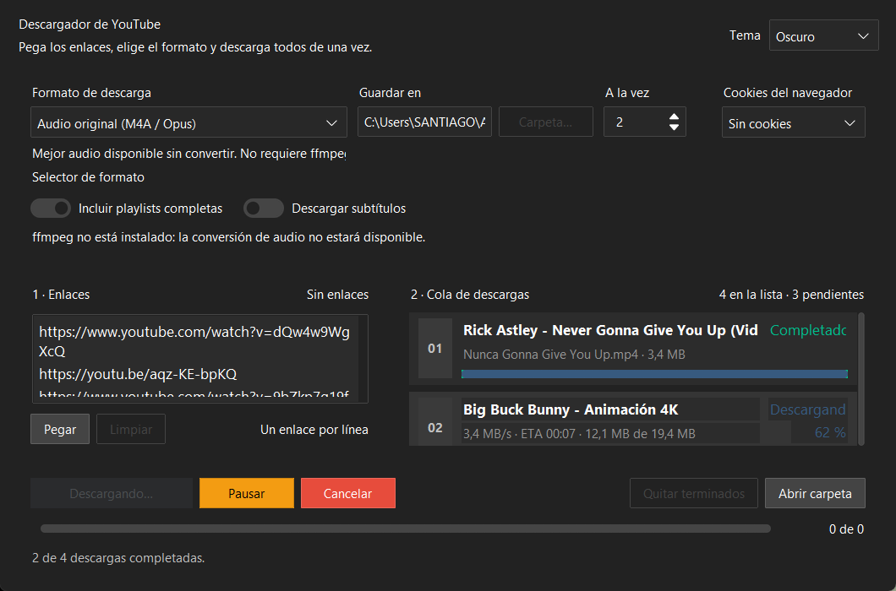

# Descargador de YouTube en lote

Aplicación de escritorio en Python para descargar **varios vídeos de YouTube a la vez**,
con selector de formato, cola de descargas con progreso en vivo y una interfaz moderna.



## Características

- **Enlaces en bloque**: pega los enlaces en el panel izquierdo, uno por línea (también
  detecta enlaces dentro de un texto copiado de cualquier navegador).
- **Formatos a elegir**: 2160p/1440p/1080p/720p/480p/360p en MP4 (H.264), máxima calidad
  automática, solo vídeo sin audio, MP3 (320/192/128 kbps), Opus, WAV, audio original o un
  **selector de formato personalizado** de yt-dlp.
- **Descargas en paralelo**: de 1 a 8 vídeos simultáneamente.
- **Cola en vivo**: título, porcentaje, velocidad, ETA, tamaño y estado de cada vídeo
  (en cola, descargando, procesando, completado, error, cancelado).
- **Pausar, reanudar y cancelar** en cualquier momento, sin perder lo ya descargado.
- **Playlists completas** (se pueden ignorar) y **subtítulos** en español/inglés.
- **Cookies del navegador** (Chrome, Edge, Firefox, Brave, Opera) para vídeos con
  restricción de edad o que piden verificación.
- **Temas claro y oscuro**, carpeta de destino configurable y preferencias que se recuerdan
  entre sesiones.

## Requisitos

- Python 3.10 o superior.
- [ffmpeg](https://ffmpeg.org/download.html) — necesario para unir la pista de audio con la
  de vídeo y para convertir a MP3/Opus/WAV. Instalación rápida en Windows:
  `winget install Gyan.FFmpeg`.
  Si falta, la aplicación **no se bloquea**: te avisa en la barra de estado y baja el mejor
  archivo disponible (audio original o vídeo sin sonido) para que la descarga termine.

## Instalación

```bash
pip install -r requirements.txt
python main.py
```

O bien, doble clic en **`iniciar.bat`**, que crea un entorno virtual y lo deja listo.

## Uso

1. Pega uno o varios enlaces en el panel **1 · Enlaces** (uno por línea).
2. Elige el **formato** y la **carpeta de destino** en el panel de opciones.
3. Ajusta **A la vez** para decidir cuántos vídeos se descargan en paralelo.
4. Pulsa **Iniciar descargas** y sigue el progreso en **2 · Cola de descargas**.

Atajos: `F5` o `Ctrl+Intro` para iniciar, y `Ctrl+V` para pegar.

## Estructura

```
pyyt/
├── main.py              punto de entrada
├── iniciar.bat          lanzador con entorno virtual
├── requirements.txt
└── ytbatch/
    ├── config.py        catálogo de formatos y opciones de yt-dlp
    ├── downloader.py    cola de descargas en hilos (sin dependencias de la GUI)
    ├── gui.py           interfaz gráfica
    └── prefs.py         preferencias entre sesiones
```

## Notas

- Los archivos se nombran `Título del vídeo [ID].ext`.
- Las descargas interrumpidas se reanudan automáticamente gracias a los archivos `.part`.
- La aplicación usa `yt-dlp`, que se actualiza con frecuencia. Si algún vídeo falla,
  actualízalo con `pip install -U yt-dlp`.
